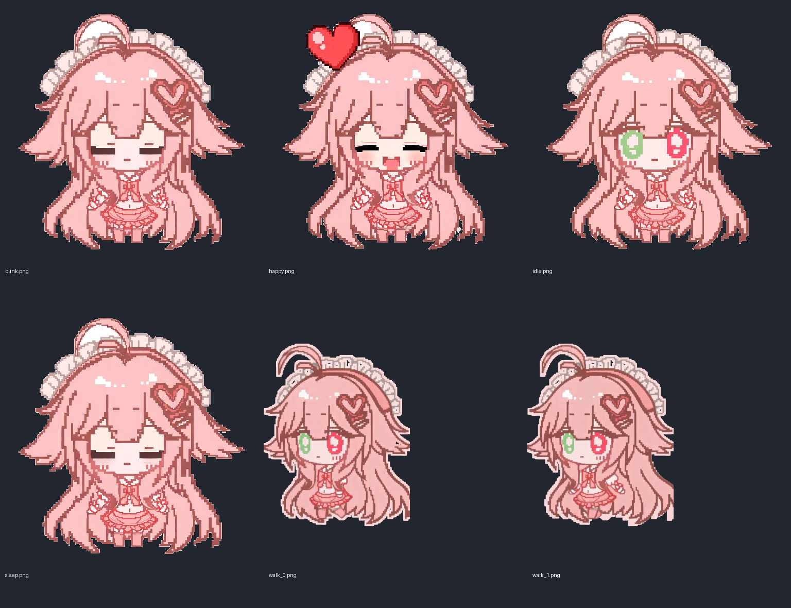
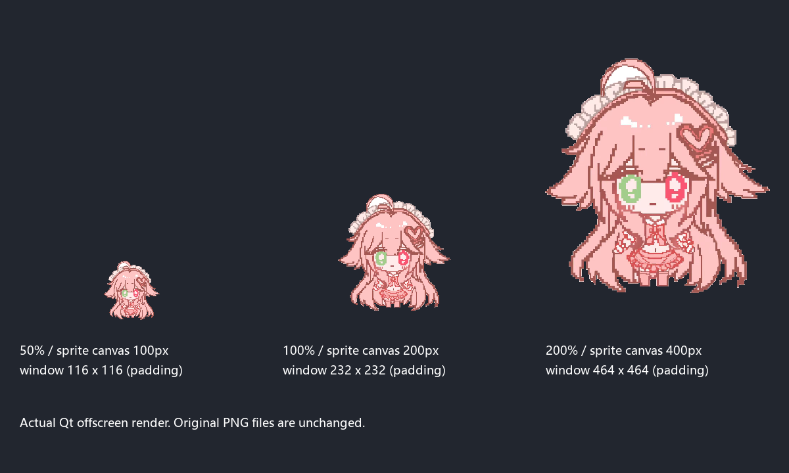

# fmm 桌宠补完计划 · 第一阶段

代号：**让芙眠眠获得完整身体**。目标版本：源码版 v0.1。

后续更新：缩放已改为右键打开独立面板，普通滚轮无效，Ctrl+滚轮为快捷方式；范围收紧至 80%～200%。已收到角色母图，并确认呆毛空隙的白色背景残留；详情与真实桌面验证见 `手机查看与缩放交互验证.md`。下文的旧范围保留作本阶段初版实施记录。

这一阶段的完成标准：能稳定启动、能自由调整大小、动作时序正确、素材轮廓干净且人物比例一致，并具有可以继续扩展的动画入口。音乐台、智能服务、养成将建立在这套底座之上。

## 现状判断

你的判断基本正确：原版只有点击、拖动、睡觉和随机走动，缺少大小调节；窗口约 30 次/秒重绘，但图片序列只有约 7.6 FPS，且走路仅两帧。它既有程序层的问题，也有素材本身不足的问题，两部分需要分别补完。

本次资源复查时，`image/` 尚无新增形象图；可用运行素材仍为原来的 6 张 PNG，其中 sleep 与 blink 重复。因此现有素材最多支撑基础修复和播放效果验证，无法直接得到自然的多动作角色。

## 素材复查结论



这张图将全部原始素材放到深色背景上，原 PNG 未改动。

| 资源 | 问题或限制 | 第一阶段处理 |
|---|---|---|
| idle / blink / happy / sleep | 同一正面形象，透明度全部为 0 或 255；有浅色轮廓，角色内部也有真实的白色头饰和高光 | 识别外轮廓残边，保留服饰和高光；确定这套形象是否作为统一母版 |
| walk_0 / walk_1 | 外侧浅色粗边尤其明显；有大量半透明像素；画布 284×512，与正面 512×512 不同 | 优先清理轮廓、统一画布与基线，再补完整步态 |
| sleep | 与 blink 逐字节相同，当前没有独立睡姿 | 单独制作闭眼呼吸/打瞌睡或真正睡姿 |
| happy | 爱心已烘焙进图里，仅靠整体跳动制造动画 | 后续制作表情与身体过渡帧；需要独立爱心时再拆层 |
| drag / wake 等 | 目前没有专用素材 | 有素材前回退到现有图，避免拿占位小黄人冒充成品 |

不能用“一键去掉所有白色”处理：那会同时损伤头饰、高光和浅色衣服。轮廓应区分背景残留、刻意描边、半透明抗锯齿，以及角色内部白色；清理结果必须在浅色、深色、棋盘格背景上对照。

当前待机和走路的角色体积、姿态、头身构图也有差别。即使把画布全部改为 512×512，角色占比仍需人工统一；仅调整缩放比例不能保证风格一致。

## 三条补完线与当前状态

| 顺序 | 名称 | 交付物 | 当前状态 |
|---|---|---|---|
| 1 | 启动机体重建 | 独立环境、通用启动器、依赖清单、日志、原始代码备份 | 已完成基础实现 |
| 2 | 动作同步率校准 | 时间驱动的行为与动画、正确睡眠、首帧重置、刷新与素材 FPS 分离 | 已完成基础实现 |
| 3 | AT 力场边界修复 | 缩放、绘图留白、当前显示器边界、设置保存 | 已完成基础实现；实机多屏长测待做 |
| 4 | 外形补完 | 统一角色母版、清理白边、统一画布/占比/脚底基线 | 已完成问题定位；素材尚未替换 |
| 5 | 动作与交互补完 | 待机、走路、睡眠、开心、被拎起、唤醒的正式动作集 | 播放参数入口已建立；素材和新触发逻辑待做 |
| 6 | 第一阶段验收 | 深浅背景、不同缩放、连续运行与屏幕切换检查 | 自动回归与短时启动通过；完整桌面验收待做 |

## 本次已经落地的源码修复

- 新建项目 `.venv`，使用 Python 3.12；已安装真实 PySide6 6.12.0 与素材工具依赖。系统默认 Python 未修改。
- 根目录 `run.bat` 启动源码版；原源码目录的 `run.bat` 也已改为使用项目环境。新增 `setup.bat` 和固定依赖清单。
- 加入日志，位于源码 `.user/runtime.log`，最多保留有限大小的轮换文件。
- 自动睡眠按最后一次真实交互时间计算，自主走路不会清零；拖动/点击/菜单操作会更新交互时间。
- 开心状态按实际秒数结束，点击睡眠状态回到清醒待机。
- 动作切换清除残留眨眼并从首帧开始，单次播放可停在末帧。
- 行走改为像素/秒，约 90 px/s，不随刷新频率翻倍；恢复卡顿时限制单次移动量。
- 滚轮缩放，右键有 50%～300% 档位，大小对应角色画布 100～600 像素。
- 窗口随大小调整，并预留动作空间，避免角色放大后仍被原 200×200 窗口裁切。PNG 保留原始分辨率，不再先缩小到 200 再放大。
- 默认使用像素清晰显示，可在菜单切换平滑显示。素材本身的低分辨率不会因此产生新细节。
- 保存大小、位置、显示方式与走动开关；位置恢复与拖动释放时执行当前屏幕边界约束。
- 右键可开关自主走动、重新加载图片和动画参数。当前只实现基础重载，不等同于完整 MOD 管理器。
- `assets/animations.json` 可分别配置现有 5 种状态的 fps、loop、facing 和 procedural；有序列时默认关闭额外呼吸/跳动。
- 修正两个素材工具重复应用 Alpha 的问题；视频工具处理透明空帧、拒绝将复杂背景静默当作白底，并清除同一状态遗留的多余数字尾帧。

原始源码和素材已备份至 `analysis/source_before_phase1.zip`。便携 EXE 与 6 张原始运行 PNG 保留，尚未重新打包，也未制作新动作图片。

## 关于“提高帧率”

必须分清三个量：

| 指标 | 修复后的策略 | 作用 |
|---|---|---|
| 窗口更新 | 16 ms 定时请求，目标约 60 次/秒 | 移动、缩放、程序动效更细；实际值受系统调度影响 |
| 素材播放 FPS | 每个动作独立配置，一般先按 8～12 FPS 制作像素动作 | 决定多久换一张图 |
| 不同姿态帧数量 | 当前走路只有 2 张，后续目标约 6～8 张 | 决定步态是否完整、动作是否自然 |

当前两帧走路暂设 8 FPS。直接设成 30/60 FPS 只会快速重复两张图，不会补出中间姿势。需要先补素材，再调播放速度；可适当使用重复帧表达停顿，但不能把重复数量算作新增姿态。

Qt 官方说明定时器可能因系统忙碌而晚触发，所以本次行为计时使用单调时间，避免依赖 tick 次数：[QTimer 文档](https://doc.qt.io/qtforpython-6/PySide6/QtCore/QTimer.html)。目标刷新频率不是性能保证，后续仍要在实机测资源占用与观感。

## 第一阶段的动作素材清单

建议先保持现有像素形象，确定统一母版后补以下动作；数量是制作目标，不是当前已有内容。

| 动作 | 建议不同姿态帧 | 建议播放节奏 | 触发方式 |
|---|---:|---|---|
| 待机 | 4～6 | 慢呼吸，8～12 FPS 配合停顿 | 默认 |
| 眨眼 | 2～3 | 快闭快开，随机间隔 | 待机期间；需增加专用眨眼序列逻辑 |
| 走路 | 6～8 | 8～12 FPS，完整迈步循环 | 自主走动 |
| 睡眠 | 4～6 | 较慢循环，可设置 4～8 FPS | 手动睡觉或久置 |
| 开心/摸摸 | 4～6 | 10～12 FPS，单次后回待机 | 单击 |
| 被拎起 | 2～4 | 轻微晃动或表情变化 | 拖动 |
| 唤醒/伸懒腰 | 3～5 | 过渡动作，单次 | 睡眠时点击；目前只回待机，专用过渡待实现 |

这套约 25～38 张不同姿态图可以形成第一版动作集。待机和行走优先级最高，其次是拖动与独立睡姿；唤醒过渡可最后补。制作前为每套动作明确：画布、人物高度、脚底基线、朝向、允许的位移、是否循环、何时退出。

首批素材可继续使用 512×512 透明画布作为交换格式；但像素画还应明确内部绘制网格和放大倍率，避免每张图的像素颗粒不同。动作之间尽量复用角色设计、调色板和身体比例。

新增动作需要接入状态和触发，当前 animations.json 不会仅凭一个新状态名自动创建菜单或行为。完整的任意动作注册、MOD 包清单、安装/启用/排序与资源覆盖规则，后续再扩展。

## 第一阶段交互边界

优先补全“看得到反馈”的基本体验：单击有完整回应、拖动有专用形象、睡眠有独立姿态、醒来有过渡；菜单能调大小、开关走动、重载素材。之后可加入少量随机待机小动作与简短气泡，但应先完成上述动作，避免行为数量增加而素材仍然复用同一张图。

音乐、AI、养成的准备工作只做到边界清晰：角色状态事件已预留信号；未来音频服务、智能控件和宠物数据模型分别连接行为层，耗时处理不放进绘图函数。第一阶段不实现 QQ/网易平台适配、不接模型账号、不制作数值养成或背包系统。

## 验收标准与已验证范围

第一阶段完整完成前，应满足：

1. 根目录双击 run.bat 可以启动源码版，异常可查日志。
2. 点击、拖动、睡眠与唤醒之间无错图；自主走动不阻止 90 秒自动入睡。
3. 大小调整与重启恢复正常；缩放不会截掉头发、脚或动作；主屏/副屏和拔插显示器行为需实测。
4. 新素材在白、深灰、棋盘格背景以及常用缩放档位下均无明显残边；服饰与眼睛高光完整。
5. 动作切换不突然变大或缩小，不因帧间裁剪而抖动；步态与移动速度协调。
6. 至少做一次 30 分钟桌面运行，观察资源占用、重绘、菜单操作、睡眠与恢复；当前尚未执行这项长测。

本次验证：真实 PySide6 的 **12 项回归检查全部通过**，包括 Qt 合成鼠标点击/拖动、滚轮、100～600 尺寸绘图、设置容错/保存、动画切换、按时间移动、自动睡眠及素材工具。离屏渲染已检查，另通过 Windows 平台插件完成短时真实事件循环启动并正常退出。

这些结果不等同于真实桌面输入、完整多显示器、DPI 切换或长时间运行验收。另启动源码 pythonw 后确认进程响应并记录启动日志，但桌面工具仍未枚举出可操作窗口，因此没有用真实鼠标完成桌面验收；该测试进程已结束。当前原始白边与两帧走路仍然保留，不能把代码修好写成素材补完已完成。



检查命令（从 fmm 根目录执行）：

```powershell
.\.venv\Scripts\python.exe -m unittest discover -s deskpet/deskpet/tests -v
.\.venv\Scripts\python.exe deskpet/deskpet/main.py --smoke-test
.\.venv\Scripts\python.exe analysis/render_phase1.py
```

下一步最优先的工作是确定统一母版，清理走路两帧的外轮廓并与待机图统一构图，然后制作完整走路循环。代码底座已经可以加载、调整和对照这批新素材。
