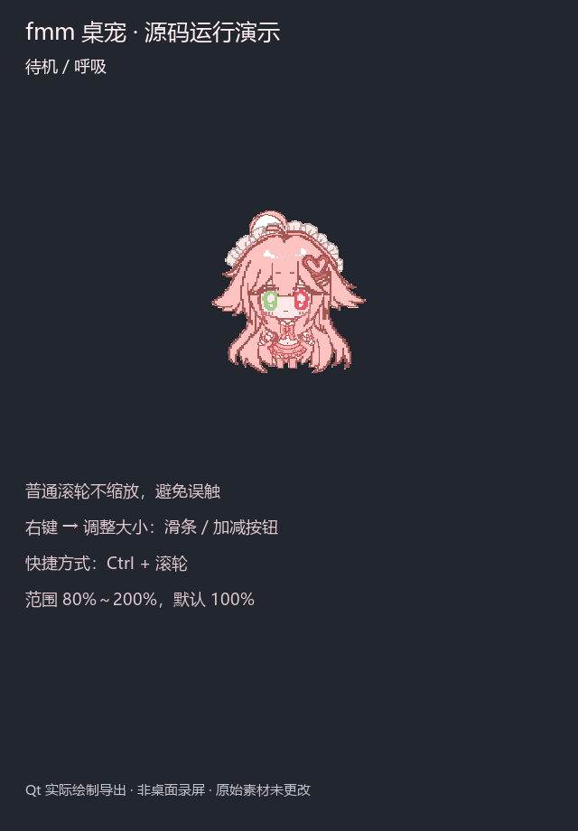

# 手机查看与缩放交互验证

本次补充完成了参考图保存、呆毛区域核对、缩放交互调整、真实桌面操作验证和演示导出。

## 参考图与呆毛结论

图一按原始 JPG 保存为 `image/fmm_master_reference.jpg`，图二保存为 `image/ahoge_white_region_reference.jpg`。未压缩、未改图，也未直接替换运行素材。

用户指出的呆毛空隙确有背景残留。母图的外部背景与呆毛拱起内部采样均为 RGB (255,223,224)；例如母图 (530,250)、(550,250)、(500,260) 均与 (100,100) 背景相同。现有 idle.png 相应空隙位置却存在 RGBA (255,255,255,255) 的不透明白块，例如 (199,56)、(210,56)。结合轮廓可确认：这部分应透出桌面背景。

正面 idle / blink / sleep / happy 的相同区域均有明显近白色区域；happy 部分被爱心覆盖。具体连通区域统计保存在 `ahoge_audit.json`。统计阈值只用于定位，不能直接用来删色。

头饰褶皱、眼睛和头发高光也有白色，仍应保留。推测原处理主要从外边缘去背景，遗漏封闭空隙；这只是对成因的推断，未证明作者当时使用的具体工具。现有工具确实从四角 floodfill，具有无法进入封闭区域的局限。本次没有修图或覆盖原始 PNG。

## 新缩放方式

- 普通滚轮不改大小。
- 右键 → 调整大小…：滑条、加减按钮、实时预览、恢复默认、确定、取消。
- Ctrl + 滚轮作为快捷方式，每格 10%。
- 统一限制在 80%～200%，默认 100%，对应角色画布 160～400 像素。旧配置越界时自动收回范围内。
- 点击确定保存；取消或关闭面板还原大小与位置。
- 面板打开时暂停角色自主动画/走动，关闭后恢复计时；避免控件跟着宠物移动。
- 实机发现旧层级会让宠物盖住面板，已修复为面板置顶、放在角色旁边，并为最大预览尽量留空间。

## 实际测试证据

14 项回归检查通过，使用真实 Qt 的离屏绘图和合成事件，新增验证普通滚轮无效、Ctrl 缩放、面板预览/取消/确定、上下限及恢复默认。Windows 平台短时事件循环启动也通过。

另外在真实桌面启动源码，使用 computer-use 操作了面板：

1. 放大按钮从 100% 改到 110%。
2. 滑条设置到 150%，面板数值随之变化。
3. 设置到 80%，缩小按钮变为禁用。
4. 设置到 200%，放大按钮变为禁用；捕获到真实桌面上的宠物。
5. 恢复默认后点击确定，读取实际 settings.json，确认 size=200。

这次实际桌面测试覆盖大小面板；普通滚轮/Ctrl 组合、点击拖动、状态时序由 Qt 回归测试验证，不把这些写成已全部用真实桌面鼠标验收。长时间、多屏、DPI 测试仍未完成。

## 查看效果

[真实桌面 200% 宠物截图](desktop_pet_200.png)

[真实大小面板截图](size_panel_desktop_200.png)

动图由实际源码 Qt 窗口在离屏事件循环中导出约 98 帧，包含待机、开心、睡眠、唤醒、走路和大小调整。它是运行绘制演示，非桌面录屏，原素材未改动。复现脚本为 `export_runtime_demo.py`。静态面板组合预览为 `size_panel_preview.png`。
