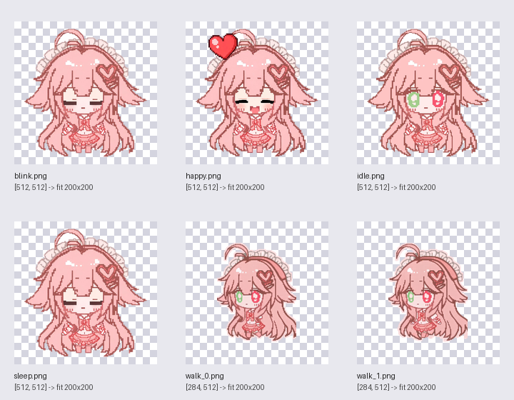

# 芙眠眠桌宠现状分析

检查日期：2026-10-15。对象：本项目现有源码、PNG 素材和便携 EXE。

结论：这是一个规模较小、可以直接修改源码的 Python / PySide6 桌宠。现有能力集中在桌面显示和简单互动；音乐台、智能控件、养成、存档、可安装 MOD 均需要后续新增。适合保留当前窗口与素材基础逐步扩展。

## 检查范围与实际运行

| 检查项 | 本次证据 | 能得出的结论 |
|---|---|---|
| 源码 | 已读全部 Python、README、BAT | 可以明确分析现有逻辑和加载方式 |
| 素材 | 已检查全部 6 张 PNG、尺寸、透明范围、哈希，并生成总览 | 已确认文件实际内容和重复素材 |
| 便携 EXE | 可用 PyInstaller 归档读取器打开，含 Python 3.13、Qt、主程序和 pet 模块 | 属于携带运行时和资源的打包程序 |
| EXE 内外素材 | 6 张全部逐字节相同 | 内外图片一致；不代表已证明打包代码与旁边源码完全一致 |
| 源码启动 | 本机默认 Python 3.9.12 执行 main.py，报缺少 PySide6 | 当前默认 Python 环境不能直接启动源码 |
| BAT 启动条件 | 写死 `C:\Users\80710\.workbuddy\binaries\python\envs\pet\Scripts\pythonw.exe`；本机不存在该路径 | 原 BAT 不具备当前电脑上的可用启动条件 |
| EXE 启动 | 启动后曾观察到两个同名进程，Responding=True；工作集约 8.9 MB / 76.5 MB | 证明启动产生进程且当时响应；不是画面或持续稳定性验证 |
| 真实 GUI 交互 | computer-use 启动报未暴露可操作窗口，刷新窗口列表仍未出现目标 | 没有完成实机点击、拖拽、右键菜单、视觉流畅度验收；也不能据此判定 EXE 无法显示 |
| 状态逻辑复现 | 导入原 character.py，以 Qt 替身执行确定性检查 | 已复现状态迁移和若干问题；不覆盖真实 Qt 定时器、绘图和系统鼠标事件 |

本次未修改原始程序、BAT 或运行素材。新增内容集中在根目录 `analysis/` 和 `image/`。

## 文件如何协作

```text
fmm/
├─ deskpet/
│  ├─ 芙眠眠桌宠便携版.exe     打包成品；自带 Python、Qt、图片
│  └─ deskpet/                 后续主要修改的源码目录
│     ├─ main.py              创建 QApplication / 素材库 / 角色 / 窗口
│     ├─ run.bat              原作者环境专用启动脚本
│     ├─ pet/
│     │  ├─ character.py      状态、行为、动画相位与计时
│     │  ├─ window.py         透明窗口、绘图、点击、拖动、菜单、移动
│     │  └─ sprites.py        PNG 加载、缓存、序列帧、缺图占位
│     ├─ assets/sprites/      源码实际读取的素材
│     └─ tools/               图片处理和视频拆帧工具
├─ image/                     本次新建；未来参考图和原始素材
└─ analysis/                  本次分析记录和检查产物
```

`双击run.bat运行` 是 0 字节提示文件，不是可执行启动器。项目没有依赖清单、打包配置、用户配置文件或自动化测试基础设施。

主要实现位置：[入口](../deskpet/deskpet/main.py#L11)、[角色状态机](../deskpet/deskpet/pet/character.py#L44)、[窗口](../deskpet/deskpet/pet/window.py#L12)、[素材库](../deskpet/deskpet/pet/sprites.py#L20)。

## 目前已经实现的功能

下表以源码为依据；真实 GUI 尚未验收。

| 功能 | 实际实现 |
|---|---|
| 桌面显示 | 固定 200×200、透明背景、无边框、始终置顶；Qt.Tool 隐藏任务栏项 |
| 初始位置 | 主屏幕可用区域的右下方，距右/下约 60 像素 |
| 左键互动 | 进入 happy，持续 45 tick，标称约 1.5 秒，再回 idle |
| 睡觉时点击 | 同样直接进入 happy，之后回 idle；不是仅切换到清醒待机 |
| 左键拖拽 | 按下后移动的曼哈顿距离超过 6 像素才进入 drag；释放回 idle |
| 拖拽形象 | 当前 DRAG_MODE="idle"，显示静止的 idle；没有启用独立 drag 素材 |
| 随机走动 | 待机每 tick 以 0.004 概率发起漫游；目标在水平 ±250 像素内 |
| 行走方式 | 每 tick 水平移动 3 像素，约 91 像素/秒；保持当前纵坐标，不会寻找桌面地面或窗口边缘 |
| 行走朝向 | 两帧素材默认朝左，向右时对整张图做水平镜像 |
| 眨眼 | 无序列帧的 idle/walk 才会新触发，间隔 60～200 tick，持续 4 tick |
| 呼吸 | idle 图片做约 ±2% 的整体等比缩放；sleep 约 ±3% 的慢速缩放 |
| 开心和行走起伏 | happy 垂直跳动最多 10 像素；walk 小幅颠簸最多 3 像素 |
| 睡觉提示 | 在图片之上额外绘制漂浮的 Z / z 字符 |
| 右键菜单 | 仅睡觉/叫醒、退出 |
| 自动睡觉 | 连续 idle 2700 tick 后睡觉，标称约 89～90 秒；有计时缺陷，见后文 |
| 缺图容错 | 找不到可读取的 PNG 时，QPainter 绘制黄色小生物占位并缓存 |

没有实现：音频播放/音乐识别、QQ 音乐/网易云联动、聊天或大模型、饥饿/心情/经验/好感度、喂食、背包、存档、托盘菜单、设置界面、快捷键体系、开机启动、MOD 管理器、自动热更新、物理重力或桌面障碍识别。

## 动画是不是“PNG PPT + 叠层”

更准确的描述是：**状态机选图 + PNG 序列帧 + 程序化变换 + 少量额外绘制**。

1. QTimer 设为 33 ms 一次，逻辑和重绘请求标称约 30 次/秒；实际调度取决于系统，不是锁定帧率。
2. 每 4 tick 切一次序列帧，所以素材播放标称约 7.6 帧/秒。它和窗口重绘频率不同。
3. 进入 idle / walk / sleep / happy 时，选择相应单张图或已加载序列帧。
4. QPainter 每次绘制一张完整角色图，应用缩放、位移和必要的镜像。
5. 睡觉时再绘制 Zzz。

**眨眼不是把眼睛 PNG 盖到身体上。** `current_sprite()` 在眨眼期间返回另一张完整图，替换本次角色图。素材名中的 `walk_blink` 是优先选择的替代图；当前并不存在这张图。走路已有序列帧，所以当前走路不会新触发随机眨眼。

现有代码没有 Live2D、骨骼、网格变形、分部件服装或发丝图层。它可以继续做出较丰富的逐帧动画，但单纯增加 PNG 不会自动生成新的行为入口。

## 现有素材的真实情况



这是文件总览，不是运行窗口截图；以 200×200 的显示框模拟各图缩放，方便对比。

| 文件 | 原图尺寸 | 实际用途/发现 |
|---|---|---|
| idle.png | 512×512 | 正面待机 |
| blink.png | 512×512 | 正面闭眼 |
| sleep.png | 512×512 | 与 blink.png 完全相同，睡眠差异由程序呼吸和 Zzz 补充 |
| happy.png | 512×512 | 笑眼、脸红和爱心已画在图片中 |
| walk_0.png | 284×512 | 行走第 1 帧，侧身全身形象 |
| walk_1.png | 284×512 | 行走第 2 帧 |

所有图片有透明通道。加载使用 KeepAspectRatio：512×512 会变成 200×200，284×512 会变成约 111×200，再在窗口中居中。PNG 自带留白也参与缩放，所以角色实际轮廓比窗口小。现有待机是较大的正面半身形象，走路是较小的侧身全身形象；切换时的视觉尺寸变化来自素材构图，不能只靠调帧率解决。

源码素材规则：

- 单张：`idle.png`、`sleep.png`、`happy.png` 等。
- 序列：`idle_0.png`、`idle_1.png`……从 0 连续编号；编号中断后后面的文件不再扫描。
- 初始化仅自动注册 idle / walk / sleep / happy 四类序列；drag 当前固定读取 idle 单图。
- 有序列时通常优先播放序列；残留眨眼仍可能短暂抢占。
- 图片在启动时扫描并缓存，覆盖文件后需要重启；没有文件监视或热重载。
- 当前读取 PNG；没有实现 GIF/APNG 动画解码、WebP 动画或直接视频播放。
- 给新动作放 `dance_0.png` 不会自动出现“跳舞”菜单；仍需接状态与触发逻辑。

**修改外部素材只影响源码运行。** 便携 EXE 内置了自己的 assets，现有路径解析相对打包模块的位置，没有寻找旁边源码目录或用户 MOD 目录的逻辑。更换外部 PNG、修改旁边 Python 后，旧 EXE 不会自动同步，需要重新打包或后续添加外置资源路径。

## 已确认的问题和扩展限制

1. **自动睡眠会被自主行为打断计时。** `_tick_walk()` 每次都把 `_awake_ticks` 清零；默认待机约数秒就可能漫游。于是“90 秒无人操作”实际成了“连续约 90 秒没有进入走路等状态”。确定性复现：禁用漫游后可正常睡觉；进入走路立即归零。后续应记录最后一次真实用户交互的时间。
2. **文档的拖动表情与代码不符。** README 写 `>_<`，当前设置却使用 idle；单独放 drag.png 也不会被这一分支使用。
3. **睡觉图是眨眼图复用。** 想要蜷缩、抱枕、盖被子，需要真正增加对应素材。
4. **眨眼能短暂覆盖新动作。** 从眨眼中点击进入 happy，`_blink` 没有清零，`current_sprite()` 先取 happy_blink，再回退 blink，因此可能先显示闭眼图一小段时间。
5. **序列帧并未关闭所有程序动效。** idle 序列关闭 idle 呼吸；但 sleep 序列依然缩放，happy / walk 序列仍叠加跳动。README 对“有序列自动关闭程序动效”的描述过于宽泛，未来高质量动作会有重复位移风险。
6. **动作共用全局帧相位。** `_anim_idx` 在所有状态持续增长，切换动作不归零，新动作不保证从第 0 帧开始；目前也没有单次播放结束事件、各动作独立帧率或权重选择。
7. **屏幕处理只针对主屏。** 初始化保存主屏可用区域；行走又按当前主屏限位。拖动没有纵向/屏幕边界修正，没有多屏切换机制；拖到主屏较远之外可能无法正常选择漫游目标。
8. **角色画布和素材缩放耦合。** CANVAS_SIZE、漫游边界和窗口大小互相关联；运行时不能调尺寸。呼吸放大或动作位移有被固定窗口裁切的风险，需在真实 GUI 中验收。
9. **没有持久化与配置层。** 参数写在代码常量中，退出后没有宠物数据或位置存档；增加养成前应先明确保存结构和版本。

## 已附带的素材处理工具

`tools/sprite_from_photo.py`：支持已有透明图、从四角 floodfill 去白底、可选 rembg 抠复杂背景，之后裁透明边、放入方形画布、缩放输出。可调底部对齐、留白、上移、像素缩放和去浅紫阴影。依赖 Pillow，AI 模式另需 rembg 和模型；本次没有安装或下载模型。

`tools/video_to_frames.py`：通过 imageio 读视频，按步长抽帧、去背景，使用各帧透明边界的并集裁剪，默认最多 12 帧、输出 512×512。它是离线素材工具，不是桌宠运行时视频播放器。

工具的注意点：

- 视频工具没有真正的 AI 去背景分支；auto 检测为复杂背景时仍进入白底处理，不能按图片工具的能力理解。
- 视频重导出覆盖同名帧，但不会清除旧的多余尾帧；例如旧 12 帧、新 8 帧，旧的 `_8`～`_11` 仍可能被加载。
- 视频中某帧完全透明时，bbox 为 None，当前并集计算没有处理。
- 图片工具逐张独立裁剪不保证多张动作的角色比例相同；动画应统一画布、人物尺度和脚底基线。
- 去阴影按颜色判断，后续处理粉紫角色素材时需要逐张检查，避免角色部分被当作阴影。

## 后续魔改如何接到现有结构

以下是后续设计建议，没有在本次实现。

| 方向 | 建议新增内容 | 与当前代码的连接点 |
|---|---|---|
| 本地助眠音乐台 | 播放列表、播放/暂停、音量、循环、定时停止；音频服务和 UI 分离 | 新建音频服务，通过信号通知角色进入听歌/助眠动作 |
| QQ/网易等外部播放联动 | 先枚举 Windows 媒体会话，显示来源/标题/播放状态，再按会话能力控制 | 独立会话适配器，避免平台逻辑进入绘图函数 |
| 更多动画和 MOD | MOD 目录、清单、独立 fps、循环/单次、锚点、朝向、程序动效开关 | 改造 SpriteLibrary 与 Character 的动作描述 |
| 智能控件 | 先做设置、音乐控制、计时器等明确用途的小窗；需要聊天时再加异步 AI 服务 | 复用 Qt 窗口，新增控制层，耗时任务不占 GUI 主循环 |
| 养宠机制 | 心情/精力/饥饿/好感度、喂食互动、冷却时间、离线结算、版本化存档 | 新增独立 PetModel，由行为状态机读取数据 |

本地播放器可使用 Qt 的 [QMediaPlayer](https://doc.qt.io/qtforpython-6/PySide6/QtMultimedia/QMediaPlayer.html) 与 [QAudioOutput](https://doc.qt.io/qtforpython-6/PySide6/QtMultimedia/QAudioOutput.html)。当前源码和便携包没有接入这套播放器，实施时需要更新依赖与打包内容。

外部音乐联动的依据是 Windows [GlobalSystemMediaTransportControlsSessionManager](https://learn.microsoft.com/en-us/uwp/api/windows.media.control.globalsystemmediatransportcontrolssessionmanager?view=winrt-26100)：它只访问已经接入系统媒体传输控制的应用。会话可以提供播放信息，并尝试播放/暂停/切歌，见 [Session 接口](https://learn.microsoft.com/en-us/uwp/api/windows.media.control.globalsystemmediatransportcontrolssession?view=winrt-26100)。因此这里的建议是先做系统会话验证，**尚不能承诺你使用的 QQ 音乐、网易云或助眠播放器版本都能完整联动**。读到曲名和播放状态，也不等于拿到音频波形、节拍、歌词或音声内容；后几项需另做输入来源与分析。

建议顺序：先建立可重复启动和打包环境、修正交互计时；再引入配置与动画清单；随后增加音乐台与状态事件；最后加入养成存档和智能服务。现有窗口和 PNG 可以保留。

## 新图片放在哪里

已新建根目录 `image/`，可以直接放你后续提供的形象图、表情图、服装、姿势、动画参考和生成结果。它目前是参考素材区，桌宠不会自动读取。

制作正式素材前，先确定形象参考、动作用途、画布和脚底基线；随后输出到源码 `assets/sprites/`，或等后续 MOD 加载层完成后放入相应 MOD 包。生图属于未来按具体素材需求进行的工作，本次没有生成或替换角色图片。

复现记录见 `inventory.json`；检查脚本为 `inspect_project.py`，仅写分析产物，不修改原程序。脚本中的 Qt 替身只用于逻辑检查，不能代替 GUI 验收。
